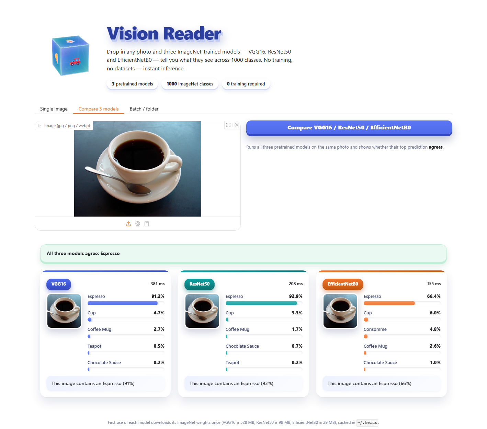
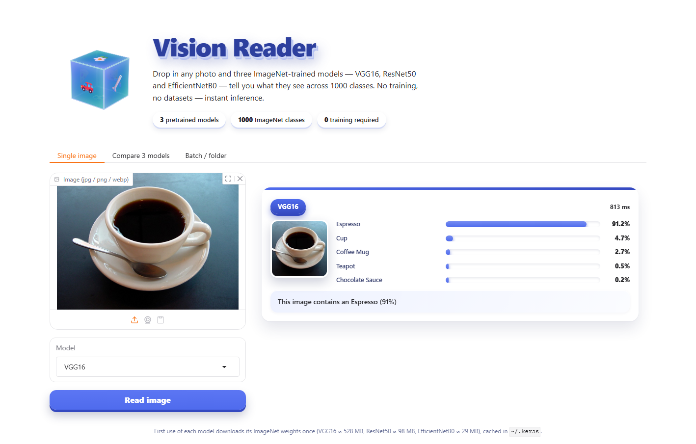

<div align="center">



# Vision Studio

**See what a photo actually contains.** Three pretrained ImageNet models — VGG16, ResNet50 and EfficientNetB0 — read your image, compare notes, and tell you the answer. Plus the pixel-level facts: sharpness, edges, colour, resolution and EXIF.

[](https://www.python.org/)
[](https://www.tensorflow.org/)
[](https://www.gradio.app/)
[](tests/test_core.py)
[](LICENSE)

**No training. No datasets. No API keys.** The weights are stock ImageNet and download once.

</div>

---

## Table of contents

- [Why this exists](#why-this-exists)
- [What it does](#what-it-does)
- [Screenshots](#screenshots)
- [Quick start](#quick-start)
- [Three ways to use it](#three-ways-to-use-it)
- [How it works](#how-it-works)
- [Project structure](#project-structure)
- [Tests](#tests)
- [Requirements](#requirements)
- [Credits](#credits)
- [License](#license)

---

## Why this exists

Most "image AI" demos are a single model behind a text box. You get one answer and no way to
tell whether it is confident or guessing.

Vision Studio gives you three independent opinions on the same photo and says out loud whether
they agree. Alongside the prediction you get the measurements a photographer, e-commerce seller
or dataset curator actually needs — resolution class, edge density, sharpness, dominant colour,
camera metadata — all computed locally, without a single outbound API call.

## What it does

| | Capability | Detail |
|---|---|---|
| 🧠 | **Object recognition** | Top-5 ImageNet predictions with confidence, across 1000 classes |
| 🤝 | **Three-model consensus** | VGG16 · ResNet50 · EfficientNetB0 side by side, with an agree / disagree banner |
| ⚡ | **CPU inference** | 150–800 ms per model on a laptop CPU — no GPU required |
| 📐 | **Resolution analysis** | Pixels, megapixels, aspect ratio, HD / 4K class, print size at 300 DPI |
| 🔍 | **Edge analysis** | Sobel gradients, optional Canny, edge density, dominant direction |
| ✨ | **Quality metrics** | Sharpness, brightness, contrast, entropy, highlight / shadow clipping |
| 🎨 | **Colour analysis** | Dominant palette, average colour, saturation, warm / cool temperature |
| 📋 | **EXIF reader** | Camera make and model, exposure, ISO, focal length, GPS presence |
| 📊 | **Batch export** | Whole folders → a tidy CSV report |
| 💻 | **Two front ends** | A Gradio web app and a Tkinter desktop studio sharing one design system |

## Screenshots

<table>
<tr>
<td width="50%">

**Single image** — one model, five ranked predictions, per-model accent colour and inference time.



</td>
<td width="50%">

**Compare 3 models** — all three models on one photo, with a consensus banner.


</td>
</tr>
</table>

## Quick start

```bash
git clone https://github.com/muneebulrehman14/vision-studio.git
cd vision-studio
pip install -r requirements.txt
python src/vision_web.py
```

The web app opens at **http://127.0.0.1:7860**.

The first time you use a model, Keras downloads its weights once
(VGG16 ≈ 528 MB, ResNet50 ≈ 98 MB, EfficientNetB0 ≈ 29 MB) into `~/.keras/models`.
After that, inference is fully offline.

> TensorFlow is optional. Without it, every pixel-level analysis still works and the UI shows a
> clear install hint instead of a broken result.

## Three ways to use it

### 1. Web app

```bash
python src/vision_web.py            # local
python src/vision_web.py --share    # temporary public Gradio link
```

Three tabs: **Single image**, **Compare 3 models**, **Batch / folder**.

### 2. Desktop studio

```bash
python src/vision_desktop.py
```

A native Tkinter app with the same palette — 3D panels, pressable buttons, a floating image
viewer with edge / colour / palette tabs, and a CSV export button.

### 3. Command line

```bash
# one image, all facts printed
python src/main.py photo.jpg

# one image, one model, written to CSV
python src/main.py photo.jpg --model EfficientNetB0 --csv report.csv

# a whole folder (recursive)
python src/batch.py photos/ --recursive --csv report.csv

# pick the interface explicitly
python src/main.py --ui web
python src/main.py --ui desktop
```

<details>
<summary><b>CSV columns produced by a batch run</b></summary>

`file`, `format`, `width`, `height`, `megapixels`, `resolution_class`, `aspect_ratio`,
`file_size_kb`, `sharpness_score`, `sharpness`, `brightness_pct`, `contrast_std`,
`edge_density_pct`, `edge_direction`, `avg_color`, `dominant_color`, `saturation_pct`,
plus per-model `*_top1`, `*_conf_pct`, `*_caption`, `*_ms`.

</details>

## How it works

```
                     ┌───────────────────────────────────────────┐
    photo ─────────► │  analysis.py   pixel facts (no TF needed)  │ ──► quality · edges · colour · EXIF
                     └───────────────────────────────────────────┘
                     ┌───────────────────────────────────────────┐
    photo ─────────► │  classifier.py  lazy TensorFlow registry   │ ──► VGG16        (138M params)
                     │  224x224 preprocess → predict → decode     │ ──► ResNet50     ( 26M params)
                     └───────────────────────────────────────────┘ ──► EfficientNetB0 (5.3M params)
                                         │
                                         ▼
                     caption.py  top-k predictions ──► "This image contains an Espresso (91%)"
```

- **Lazy loading.** TensorFlow is imported the first time a prediction is requested, so the UI,
  the pixel analysis and the test suite start instantly on machines without it.
- **One registry, three models.** `Classifier` caches each model after first use, which is why
  the second and third model in a comparison run 3–5x faster than the first.
- **No shared-state bugs.** Model loading and inference are serialised behind a lock, so the
  Gradio server stays correct when several browser tabs fire at once.

## Project structure

```
vision-studio/
├── src/
│   ├── analysis.py        # edges, quality, colour, resolution, EXIF — pure NumPy/Pillow
│   ├── classifier.py      # lazy TensorFlow registry for the three models
│   ├── caption.py         # top-k predictions → one English sentence
│   ├── theme.py           # shared light design system (colour, depth, CSS)
│   ├── vision_web.py      # Gradio app
│   ├── vision_desktop.py  # Tkinter studio
│   ├── batch.py           # folder → CSV, headless
│   └── main.py            # unified CLI entry point
├── tests/
│   └── test_core.py       # 22 tests, no network, no TensorFlow needed
├── assets/                # screenshots + demo image
├── requirements.txt
└── LICENSE
```

## Tests

```bash
python tests/test_core.py
```

22 checks covering resolution maths, edge and quality metrics, colour extraction, EXIF parsing,
caption generation, folder discovery and CSV output. They run in about a second and need neither
TensorFlow nor network access.

## Requirements

| Package | Needed for |
|---|---|
| `numpy`, `Pillow` | all pixel analysis |
| `tensorflow` | object prediction (optional) |
| `gradio` | web app (optional) |
| `opencv-python` | true Canny edges (optional) |
| `matplotlib` | CLI charts (optional) |

`tkinter` ships with CPython on Windows and macOS. On Debian/Ubuntu: `sudo apt install python3-tk`.

## Credits

- Demo photograph: ["A small cup of coffee"](https://commons.wikimedia.org/wiki/File:A_small_cup_of_coffee.JPG)
  via Wikimedia Commons.
- Pretrained weights: Keras Applications (ImageNet).
- Design: one shared light theme (`src/theme.py`) drives both the web and desktop interfaces.

## License

MIT — see [LICENSE](LICENSE). Use it, fork it, ship it.

<div align="center">
<sub>Built with Python, TensorFlow and a stubborn refusal to call an external API.</sub>
</div>
